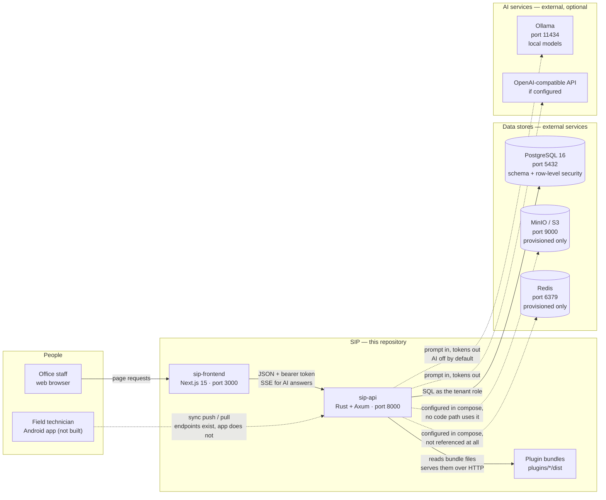
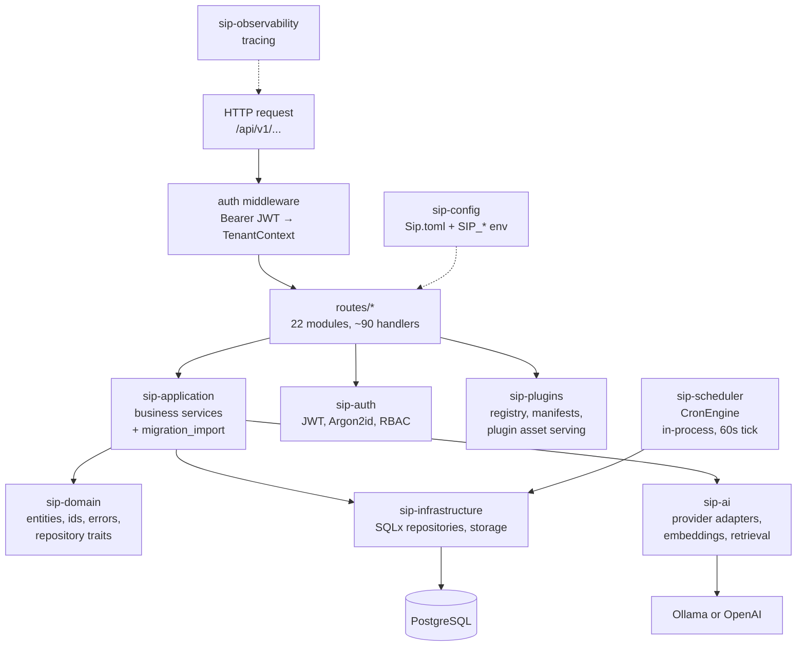
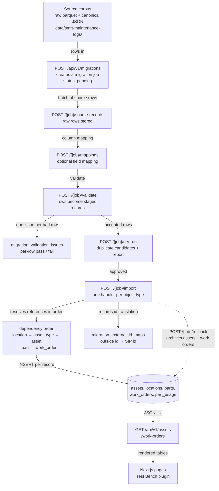
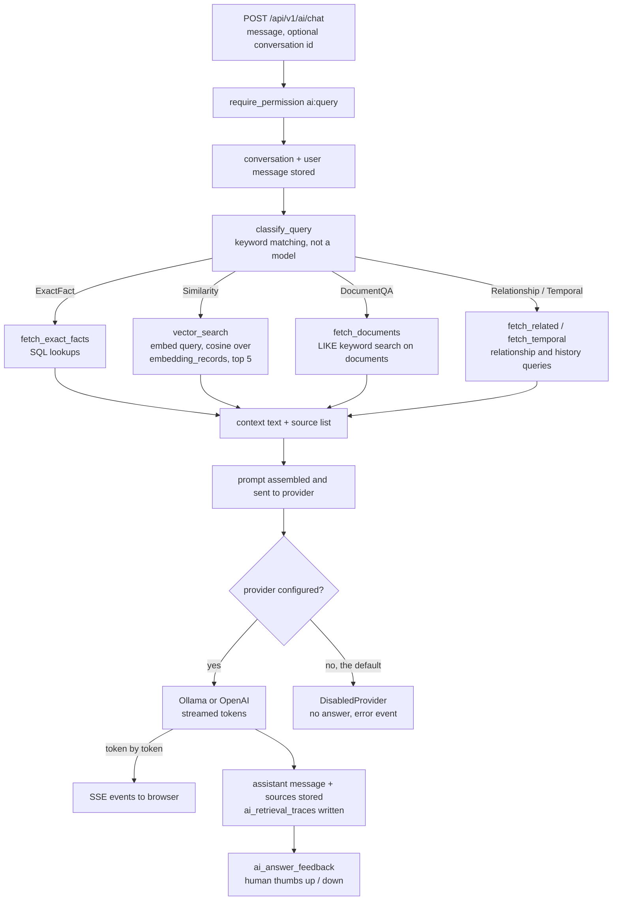
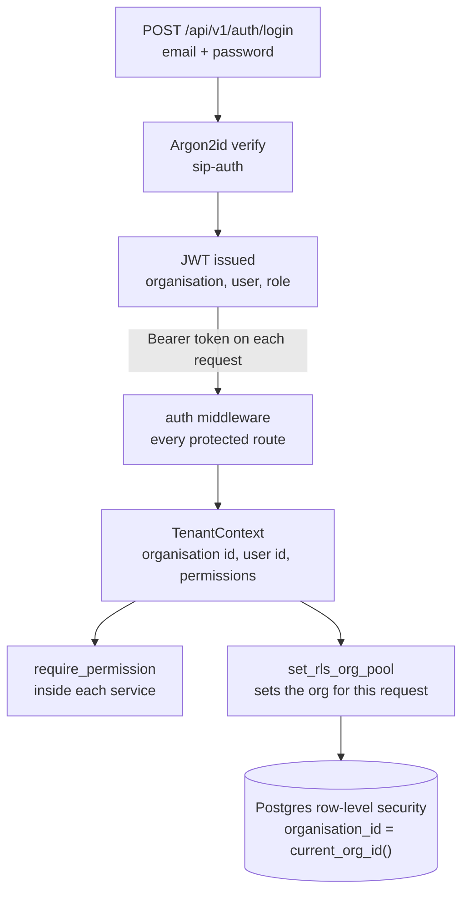
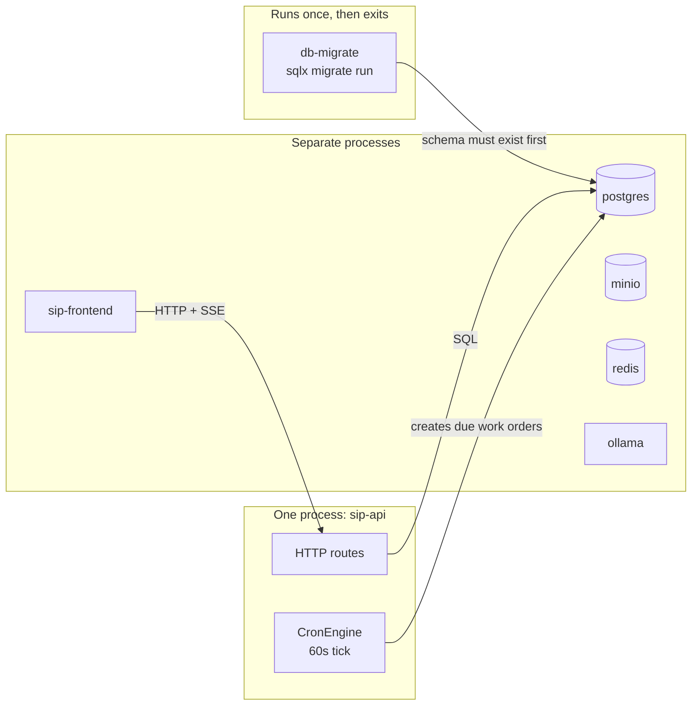

# SIP — Service Intelligence Platform: Architecture Guide

This guide describes SIP as the code in this repository actually behaves. It was
written by reading the Rust workspace, the HTTP route table, the database
migrations, and the deployment files — not by trusting earlier documentation.

Where the code and the docs disagreed, the code won. Where something exists but
nothing calls it, that is stated plainly rather than drawn as if it worked.

**Status labels used throughout**

| Label | Meaning |
|---|---|
| **Implemented** | The code path exists and I traced or exercised it end to end. |
| **Present but unused** | Code and configuration exist, but nothing calls them at runtime. |
| **Planned / placeholder** | An explicit stub, `TODO`, or empty implementation in the source. |
| **Unverified** | Built, but I could not run it in this environment. |

**What I read**

`Cargo.toml` (21 workspace crates) · `crates/sip-api/src/main.rs` (route table,
startup) · `crates/sip-api/src/routes/**` · `crates/sip-application/src/services.rs`
· `crates/sip-infrastructure/src/repositories.rs` · `crates/sip-ai/src/**` ·
`crates/sip-scheduler/src/cron.rs` · `migrations/001…010` · `docker-compose.yml` ·
`docker/Dockerfile.*` · `frontend/**` · `Sip.toml`

---

## 1. Big-picture architecture

SIP is two applications and a database. A Next.js frontend renders the interface;
a single Rust binary (`sip-api`) does all the work behind it; PostgreSQL holds
everything. Everything else in the diagram is either an optional external service
or a subsystem that is present in the code but not yet connected.

### 1a. The pieces and how they talk

**How to read it.** Solid arrows are paths the running code actually takes. Dashed
arrows are configured or intended but not exercised. The frontend never talks to
the database; it only calls the API. The API is the single place where business
rules, permissions and SQL meet.

**Established by:** `docker-compose.yml` (services and ports),
`frontend/next.config.ts`, `crates/sip-api/src/main.rs`, `Sip.toml`.

### 1b. Inside the API — the layers

The API is one process, but the Rust workspace splits it into layers so that each
piece can be tested and replaced. A request travels down and the result travels
back up.

**How to read it.** Each box is a crate. Arrows point in the direction of the
dependency: `routes` calls `sip-application`, which calls `sip-domain` for rules
and `sip-infrastructure` for SQL. `sip-domain` never imports the others, which is
why the business rules are testable without a database.

**Established by:** `Cargo.toml` workspace list; `crates/sip-api/src/main.rs`;
`crates/sip-application/src/services.rs`; `crates/sip-infrastructure/src/repositories.rs`.

### 1c. What each component is for

| Component | What it does | Status |
|---|---|---|
| `sip-frontend` | Next.js 15 app-router UI. 21 client-side pages plus a catch-all route that hosts plugin UIs in a sandboxed iframe. | **Implemented** |
| `sip-api` | The only backend. Axum HTTP server: authentication, ~90 handlers, SSE streaming for AI, plugin bundle serving. | **Implemented** |
| `sip-domain` | Entities (asset, work order, part, location…), ID types, error types, repository traits. No I/O. | **Implemented** |
| `sip-application` | Business rules and orchestration: services plus the migration importer. | **Implemented** |
| `sip-infrastructure` | SQLx implementations of every repository, plus object-storage and Redis modules. | **Implemented** (storage/Redis modules unused) |
| `sip-auth` | Password hashing (Argon2id), JWT issuing/verification, RBAC permission checks. | **Implemented** |
| `sip-tenancy` | Tenant scoping helpers. | **Implemented** |
| `sip-plugins` | Plugin manifest parsing, validation, registry, extension points, public "UI view" of a plugin. | **Implemented** |
| `sip-scheduler` | `CronEngine` — every 60s, creates work orders from due preventive schedules. Started inside the API process. | **Implemented** |
| `sip-ai` | Provider abstraction (trait), Ollama/OpenAI adapters, embedding calls, citation types. | **Implemented**; retrieval service is a stub |
| `sip-search` | Search indexers and repository. | **Present but unused** |
| `sip-outbox` | Transactional outbox poller (reliable event delivery). | **Present but unused** |
| `sip-documents` | Document processing and repositories. | Partially wired (no upload route) |
| `sip-activity`, `sip-assets`, `sip-work-orders`, `sip-parts` | Domain-grouped modules. | **Implemented** |
| `sipmem-core`, `sipmem-adapters` | Memory/evidence/RAG primitives: retrievers, router, verifiers, verification traces. | **Present but unused** — not imported by the API or application |
| `sip-cli` | Admin CLI: `migrate`, `seed`, `export`, `reindex`. | **Planned / placeholder** — every subcommand only logs a message |
| `sip-observability` | Tracing initialisation. | **Implemented** |

**External services** (not SIP code): PostgreSQL 16, MinIO/S3, Redis, Ollama, and
optionally an OpenAI-compatible endpoint.
**Bundled third-party pieces:** pgvector, `ltree`, `pg_trgm`, `uuid-ossp` — Postgres
extensions enabled by the migrations. PostGIS is present in the migrations but
commented out and not required.

---

## 2. How information moves through SIP

The clearest implemented end-to-end path is **importing service history**. It is
also the path most relevant to a field-service business: maintenance records from
outside SIP become assets, parts and work orders that a technician can then see and
edit.

The example is the SMRT maintenance corpus in this repository
(`data/smrt-maintenance-logs/`) — 10,785 real maintenance narratives mapped to 585
assets, 766 parts and 10,785 work orders.

### 2a. The import pipeline

**How to read it.** Read top to bottom. Each box is a stage, and the arrow labels
are what moves to the next stage. Every stage is triggered by an explicit HTTP
call from the client or the import script — nothing runs on a timer. The job
status (`pending → validating → importing → completed`) is what makes the pipeline
resumable: a crash leaves a job in a known state rather than half-written rows.

### 2b. What actually happens at each step

| Step | Trigger | What SIP does | Stored in |
|---|---|---|---|
| 1. Create job | `POST /api/v1/migrations` | Creates a job row scoped to the caller's organisation | `migration_jobs` |
| 2. Upload rows | `POST /{job}/source-records` | Stores the raw records exactly as received, in batches | `migration_source_records`, `migration_batches` |
| 3. Map fields | `POST /{job}/mappings` | Optional. With **no** mapping, records are treated as already canonical | `migration_field_mappings` |
| 4. Validate | `POST /{job}/validate` | Type-checks each record and reports per-row issues | `migration_staged_records`, `migration_validation_issues` |
| 5. Dry run | `POST /{job}/dry-run` | Reports what would be created and what looks duplicated | `migration_duplicate_candidates` |
| 6. Import | `POST /{job}/import` | Dispatches each staged record to a handler for its object type | `assets`, `locations`, `parts`, `work_orders`, `part_usage` |
| 7. Translate ids | during import | Records which outside identifier became which SIP id, so later records can reference it | `migration_external_id_maps` |
| 8. Read it back | `GET /api/v1/assets`, `/work-orders` | The ordinary list endpoints serve the imported rows | — |
| 9. See it | page load | Next.js pages and the Test Bench plugin render the data | — |

**Verified end to end.** I imported this corpus into a scratch database during
this work: 12,144 records across 7 locations, 1 asset type, 585 assets, 766 parts
and 10,785 work orders, with a separate validator performing 254,463 checks and
reporting zero errors.

### 2c. Where this flow stops

- **Rollback is partial.** `POST /{job}/rollback` archives assets and work orders.
  Locations, asset types, parts, manufacturers and models have no archive path, so
  the rollback report marks them `rollback_skipped` rather than deleting them.
  A partial rollback is reported as partial, not as success.
- **Historical part usage does not touch stock.** Importing a 2020 repair records
  the part-usage row but does not decrement `parts.quantity_on_hand`, because
  back-filling history must not drain today's inventory.
- **There is no upload path for documents.** `GET`/`PATCH`/`archive` exist for
  documents; nothing accepts a file. So document text can never enter SIP through
  the API, which is why the document half of the AI story is inert (§3).

---

## 3. Where the intelligence happens

AI is **off by default**. `Sip.toml` has no `[ai]` section, and the compiled
defaults are `enabled = false` and `provider = disabled`. With AI off, the chat
endpoint still validates the request and stores the conversation, but no answer is
produced.

There is exactly one AI entry point: `POST /api/v1/ai/chat`, which streams its
answer as Server-Sent Events.

### 3a. The AI request path

**How to read it.** The important arrow is the dashed-in-spirit one: the model
never sees the database. It only sees the text in `context`, which is assembled by
SIP from the paths above. That is the whole security model for AI here — the model
cannot retrieve anything the requesting tenant could not already read, because
retrieval runs as that tenant.

### 3b. What each retrieval path really does

| Path | Triggered by | Real behaviour | Status |
|---|---|---|---|
| `SQL` | questions containing "serial", "status of", "assigned to"… | Direct SQL lookups; sources marked `verified_by_sql = true` | **Implemented** |
| `VECTOR` | "similar", "pattern", "same issue"… | Embeds the question, then `ORDER BY embedding <=> query` over `embedding_records`, top 5, tenant-scoped | **Code implemented, index never populated** |
| `RAG` | "manual", "procedure", "how to"… | Falls back to `LIKE '%keyword%'` over document names and text. Source contains `TODO: Integrate pgvector` | **Planned / placeholder** |
| `GRAPH` | "connected to", "related", "depends on" | Relationship queries across assets/locations | **Implemented** (SQL joins, not a graph database) |
| `TEMPORAL` | "what changed", "history of", "trend" | History and change queries | **Implemented** |

**The critical honesty point:** the vector path is real code, but nothing ever
writes to `embedding_records`. The repository method `insert_embedding_record`
exists and is implemented, and **nothing calls it** — not the API, not document
processing, not the CLI (whose `reindex` subcommand only logs). Likewise
`document_chunks` is never inserted into. So in a running system the vector path
returns nothing, and questions that need it fall back to SQL or keyword matching.

This is worth stating precisely because the code *looks* complete: the SQL is
correct, the `<=>` operator is used properly, and the tenant filter is right. The
missing piece is an indexing pipeline, not a search implementation.

### 3c. Validation and human review that actually exists

| Control | Reality |
|---|---|
| SQL-verified sources | Real: facts fetched by SQL are tagged `verified_by_sql = true` in the source list. |
| Retrieval traces | Real: `ai_retrieval_traces` records which retriever ran, the score, rank, and whether the source was verified. |
| Citations to the user | Real: `sip-ai/src/citations.rs` and a `sources` array on each stored message. |
| Human feedback | Real storage: `ai_answer_feedback` accepts thumbs up/down per answer. |
| Automated answer verification | **Not implemented** in the live path. `sipmem-adapters` contains verifiers and `verification_traces` exists, but nothing in the API calls either. |
| Human approval before acting | **Does not exist.** The AI cannot write to the database; it only answers. |

**Provider support, precisely:** only **Ollama** and **OpenAI** have working
adapters. `Anthropic`, `OpenRouter`, `AzureOpenAI`, `Bedrock` and `CustomHttp` are
enum values that fall through to a logged warning and the disabled provider — the
source says "Placeholder for future provider implementations".

**Embeddings** are only implemented for Ollama and OpenAI. Even with the vector
path wired, embedding a question requires a configured provider; otherwise
`vector_search` returns an empty list rather than failing.

---

## 4. Authentication and tenant separation

Two independent mechanisms, deliberately overlapping.

**How to read it.** The left half is *who you are*; the right half is *what the
database will let you touch*. A request must pass both. Even if a handler forgot a
permission check, the row-level policies still return only that tenant's rows.

- **Passwords** are Argon2id (`Argon2::default()`), verified in `sip-auth/src/passwords.rs`.
- **Sessions** are JWTs in an `Authorization: Bearer` header. There are no session
  cookies, which is why the frontend can be served from a different origin than the
  API.
- **Permissions** are strings such as `asset:read`, `work_order:create`, `ai:query`,
  checked at the top of each service method.
- **Tenant isolation** is enforced a second time by PostgreSQL: every tenant table
  has a policy `organization_id = current_org_id()`, and repositories call
  `set_rls_org_pool` before querying (`migrations/003_rls_policies.sql`).
- **Production guardrails:** configuration validation refuses a JWT secret shorter
  than 32 characters in staging/production, warns when CORS still has the localhost
  default, and warns when HTTPS is not enforced (`sip-config/src/lib.rs`).

Two things to know about the defaults: the committed `Sip.toml` contains a
development JWT secret, and leaving CORS unset in production falls back to a
**permissive** CORS layer with only a warning.

---

## 5. What runs together, and what runs independently

- **Together, in the API process:** HTTP handling and the cron engine. The cron
  engine is spawned inside `sip-api` when `features.dispatch_enabled` is true
  (default true) and every 60 seconds walks every organisation's active schedules,
  creating work orders that are due.
- **Separately:** the frontend, PostgreSQL, MinIO and Ollama are distinct
  containers. Redis and MinIO are provisioned but no running SIP code uses them.
- **Once, then exit:** `db-migrate` applies migrations and stops. The API is
  configured to start only after it completes successfully.
- **Not running at all:** there is no separate worker binary. `sip-cli` builds but
  performs no work, so nothing exists that could run a queue outside the API.

---

## 6. Deployment: what the configuration establishes, and what is unverified

**Docker Compose** (`docker-compose.yml`) establishes a single-host deployment:
Postgres, Redis, MinIO, Ollama, the API, a one-shot migration service, and the
frontend on a private network, with the API publishing 8000 and the frontend 3000.
The API waits for Postgres, Redis and MinIO to be healthy and for migrations to
finish.

**Docker images** (`docker/Dockerfile.api`, `docker/Dockerfile.frontend`): the API
is a compiled Rust binary with `SIP_BUILD_COMMIT` baked in, exposed at
`/api/v1/capabilities` so a running container can be matched to a commit. The
frontend is a Next.js standalone build with `NEXT_PUBLIC_API_URL` inlined at build
time — changing the API URL requires rebuilding the image.

**Vercel** (`frontend/vercel.json`, `docs/deployment/vercel.md`): the frontend only.
The Rust API cannot run there: it is a long-lived server with SSE streaming, an
in-process cron loop, and plugin bundles read from disk.

### Unverified in the running environment

I could not start the Compose stack here (Docker requires an interactive `sudo`
password on this machine), so:

- The **composed stack as a whole is unverified.** No `docker compose up` has
  completed; there is no up-log.
- What *is* verified: the API binary running on the host against the real
  PostgreSQL, Redis and MinIO containers. Routes, authentication, proximity search,
  work-order creation, sync push/pull and the migration import were exercised that
  way.
- **Unverified:** image builds, the Ollama model pull (`llama3.1:8b` is pulled at
  container start), MinIO bucket creation, the `db-migrate` one-shot, and any
  Vercel deployment.
- **The Android app does not exist.** The sync endpoints it would use are
  implemented and tested; the client is not written.

---

## 7. Implemented, planned, unknown — in one place

**Implemented and exercised**
- HTTP API with 22 route modules and ~90 handlers, JWT auth, RBAC, tenant RLS
- Work order lifecycle, assets, parts, locations, schedules, inspections, documents (read/archive), users, teams
- Migration pipeline: source records → validate → dry-run → import → report → partial rollback
- Proximity search: `GET /api/v1/locations/near`
- Offline sync: idempotent `POST /api/v1/sync/push`, cursor-based `GET /api/v1/sync/pull`
- Plugin registry, manifest validation, and `standalone` plugin hosting in a sandboxed iframe
- Cron-driven preventive work order creation inside the API process
- AI chat endpoint with SSE, conversation storage, SQL/relationship/temporal retrieval, citations, feedback storage

**Implemented but never called**
- Vector retrieval over `embedding_records` — no indexing pipeline writes to it
- `sip-outbox` poller, `sip-search` indexers, `sipmem-*` memory/verifier stack
- MinIO object storage and Redis clients — configured, not used by any request path

**Planned / placeholder**
- Document upload and text extraction (no upload route at all)
- pgvector document RAG (`TODO` in `fetch_documents`)
- Anthropic, OpenRouter, Azure, Bedrock, CustomHttp providers (enum values only)
- `sip-cli` subcommands
- Marketplace (`marketplace_enabled = true`, no implementation)
- MCP tool serving — `McpToolDef` is declared and validated in plugin manifests, but nothing exposes it

**Unknown / unverified**
- Composed Docker deployment, image builds, Ollama model availability, Vercel deployment
- Behaviour under concurrency (the display-number allocation retries on collision, but I did not load-test it)
- Whether the seeded demo hash matches its documented password — it does **not**; see below

**Known defects I found while tracing this**
- The committed seed in `004_seed_data.sql` has a placeholder password hash that
  does **not** verify against `password`, so a fresh database cannot log in as the
  README describes.
- `locations.geo` (JSONB) was never selected, so coordinates were always null until
  typed columns were added.
- Create work order used `RETURNING *`, which returned raw `NUMERIC` that could not
  decode — the row was inserted and the caller still received an error, which on
  retry produced duplicates.

---

## 8. The short version

SIP is a web application with a Rust backend and a Next.js frontend, backed by one
PostgreSQL database that enforces tenant separation itself.

Office staff use the browser. The browser never touches the database; it calls one
API, and that API decides what a person is allowed to see and do. The database is
the second line of defence: even a buggy API call can only reach the rows belonging
to that customer.

Data gets in through the migration pipeline, which is the most complete piece of
the system: raw records are stored untouched, validated row by row, dry-run to spot
duplicates, then imported in dependency order so that a work order can reference an
asset that already exists. Everything after that is ordinary CRUD — the same API
lists those assets and work orders for the web interface.

The intelligence layer is genuinely present but deliberately modest. There is no
agent that acts on its own; the AI reads a question, SIP assembles a context from
the database using SQL, relationship and history queries, and the model writes an
answer over that context. It cannot see anything the user could not already read.
The semantic-search path — embeddings and vector similarity — is written but never
fed, because nothing in SIP yet builds an index of embeddings. That is the single
largest gap between how the AI looks and how it behaves.

For a field technician, the pieces exist but the app does not: site lookup by GPS
and offline sync with idempotent retries are implemented and tested on the server,
waiting for a client.

---

## Diagrams

Editable Mermaid source is inline above; the files below were rendered from it with
Mermaid 11. Each has a `.svg` (scales cleanly) and a `.png` (opens anywhere) copy.
To change a diagram, edit the Mermaid block above and re-render — the Markdown is the
source of truth, the SVG/PNG are outputs.

- [`diagrams/01-system-context.svg`](diagrams/01-system-context.svg)
- [`diagrams/02-api-layers.svg`](diagrams/02-api-layers.svg)
- [`diagrams/03-import-pipeline.svg`](diagrams/03-import-pipeline.svg)
- [`diagrams/04-ai-path.svg`](diagrams/04-ai-path.svg)
- [`diagrams/05-auth-tenancy.svg`](diagrams/05-auth-tenancy.svg)
- [`diagrams/06-processes.svg`](diagrams/06-processes.svg)
